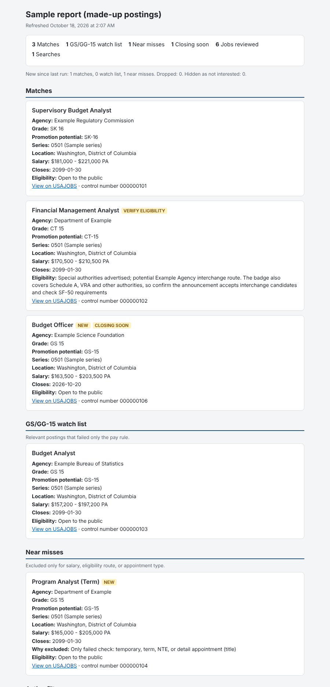

# usajobs-monitor

A scheduled job search for [USAJOBS](https://www.usajobs.gov) that does the filtering a keyword search can't. You describe the jobs you want and the hiring paths you qualify for in one config file, and each run gives you a short list of postings worth reading, a watch list, and the near misses, with a reason for every job it set aside.

> **Status:** early, but complete for everyday use. The core search, filtering, tracking and reports are ported from a personal tool that runs three times a week. Delivery by email, Discord, Slack and ntfy is in, it can run on GitHub Actions or in Docker, `usajobs-monitor init` sets up a profile for you, and an optional AI add-on rates your resume against each job, lists stronger fits first and serves the search to AI assistants over MCP. See [Roadmap](#roadmap) for what's next.

## What a report looks like



This is the HTML digest from [a sample run](docs/sample/usajobs_digest.html) with made-up postings and agencies. [`scripts/make_sample_report.py`](scripts/make_sample_report.py) regenerates it offline.

## Quickstart

About five minutes once you have an API key. Needs Python 3.11 or newer.

```bash
# 1. Get a free API key: https://developer.usajobs.gov/apirequest/ (it's emailed to you)
git clone https://github.com/amv2/usajobs-monitor.git && cd usajobs-monitor
python3 -m venv .venv && source .venv/bin/activate && pip install -e .

export USAJOBS_EMAIL="you@example.com"        # the address you registered with
export USAJOBS_API_KEY="paste-your-key-here"

usajobs-monitor init      # six questions, writes your profile
usajobs-monitor run       # search, filter, write reports (the init output shows the exact flags)
```

Open the HTML digest in your reports folder. Then read the near misses: each one says which single check it failed, which is the fastest way to tune your profile. To run it automatically, see [step 7](#7-run-it-on-a-schedule). The numbered sections below cover each step in detail.

## What it does

- **Searches USAJOBS through the official API.** It runs every search in your profile, reads every page of results (500 per page, up to 10 pages), and warns you when a search was cut off.
- **Filters out what boilerplate hides.** Keyword searches return lots of noise. This tool checks the structured fields instead:
  - temporary and term jobs, from the appointment-type code rather than the title
  - senior executive roles, from the pay plan (SES and equivalents, plus any pay plans you list)
  - wrong occupations, from whole words in the title together with the job series
  - excluded job series, but only when *every* series on the posting is excluded
- **Screens eligibility.** It checks whether you can actually apply: open to the public, internal to your current agency, competitive status, excepted service, interchange agreements (including postings that explicitly deny them), special hiring authorities, and any extra hiring paths you list.
- **Sorts results into tiers:**
  - **Matches** pass every check.
  - **Watch list** jobs fail only on posted salary, at a grade you've chosen to keep an eye on.
  - **Near misses** fail exactly one check, shown as "Only failed check: …". Hard-no failures (wrong occupation, executive role, another agency's internal posting) never appear here.
- **Remembers between runs.** Each job is flagged **NEW** the first time it appears and **CLOSING SOON** when three days or less remain, and jobs that disappeared are noted. You can record a decision (applied, not interested, watching) so a job stops nagging you.
- **Runs safely on a schedule.** Each run works in its own folder and publishes reports only after they pass validation. A lock stops two runs from overlapping, and a failed run never overwrites the last good report or puts raw errors in anything that gets sent to you.
- **Delivers results where you'll see them.** Email through any SMTP server with the reports attached, or a short digest to Discord, Slack or ntfy. A retry never sends the same run twice.
- **Optional AI help, off by default.** Each run can add short notes comparing your resume with each match (a fit level, gaps, resume wording to fix) and list stronger fits first without hiding any job, using a subscription you already have through the Claude Code, Codex or Gemini command-line tools, a local model with Ollama, or an API key. [docs/AI.md](docs/AI.md) compares the options. With the `mcp` extra, an AI assistant such as Claude Desktop can search and screen postings through your profile. Nothing in the core needs either one, and your resume is sent only when you turn that on.
- **Sets itself up.** `usajobs-monitor init` asks a few questions and writes your profile, with starting eligibility for your applicant type: current federal employee, excepted service, veteran, military spouse, student, recent graduate, former federal employee, Schedule A, or the general public.

Output is your choice of an HTML digest (`usajobs_digest.html`), a CSV of every job reviewed (`usajobs_jobs.csv`), a Word briefing (`usajobs_briefing.docx`) and an Excel tracker (`usajobs_tracker.xlsx`), plus a `usajobs_last_run.json` summary. Profiles written by `init` use HTML and CSV; older profiles keep Word and Excel until you set [`report.formats`](docs/CONFIG_REFERENCE.md#report-and-scoring).

## Requirements

- Python 3.11 or newer
- A free USAJOBS API key (next section)
- macOS, Linux or Windows

## 1. Get a USAJOBS API key

1. Go to the [USAJOBS developer site](https://developer.usajobs.gov/) and choose **Request an API Key** (the form is at <https://developer.usajobs.gov/apirequest/>).
2. Enter your name, email address and a short description such as "personal job search alerts".
3. USAJOBS emails you the key. It usually arrives within a few minutes but can take longer.

Keep two things: the **key** and the **email address you registered with**. The API requires both on every request (the email is sent as the `User-Agent` header), so use the same address you signed up with.

Don't paste the key into the config file or any file you might commit. Step 3 shows where it goes.

## 2. Install

```bash
git clone https://github.com/amv2/usajobs-monitor.git
cd usajobs-monitor
python3 -m venv .venv
source .venv/bin/activate            # Windows: .venv\Scripts\activate
pip install -e .
```

If you use [uv](https://docs.astral.sh/uv/): `uv venv && uv pip install -e .`

Prefer containers? Skip the Python setup and see [Docker](#docker) under step 7.

Check the install:

```bash
usajobs-monitor --help
```

## 3. Add your credentials

Set them as environment variables. The tool reads `USAJOBS_EMAIL` and `USAJOBS_API_KEY` and these take precedence over anything in a config file.

macOS / Linux (add to `~/.zshrc`, `~/.bashrc` or a file you `source` before running):

```bash
export USAJOBS_EMAIL="you@example.com"
export USAJOBS_API_KEY="paste-your-key-here"
```

Windows (PowerShell, saved for your user account):

```powershell
[Environment]::SetEnvironmentVariable("USAJOBS_EMAIL", "you@example.com", "User")
[Environment]::SetEnvironmentVariable("USAJOBS_API_KEY", "paste-your-key-here", "User")
```

Open a new terminal afterwards so the variables are picked up.

### Or keep them in your system keychain

Instead of environment variables, you can store credentials in your operating system's encrypted vault: Keychain on macOS, Credential Manager on Windows, or Secret Service (GNOME Keyring, KWallet) on Linux. Install the optional extra, then save each value. You're prompted for it and nothing is shown as you type:

```bash
pip install -e ".[keyring]"
usajobs-monitor credentials set USAJOBS_EMAIL
usajobs-monitor credentials set USAJOBS_API_KEY
usajobs-monitor credentials status          # where each one comes from; never prints values
```

The same command stores delivery secrets from [step 6](#6-get-results-delivered), for example `usajobs-monitor credentials set USAJOBS_SMTP_PASSWORD`, and `credentials status --config your-profile.toml` lists the ones your profile needs. `credentials delete NAME` removes one.

How it fits together:

- **An environment variable always wins.** The keychain is only read for a variable that isn't set, so existing setups keep working unchanged.
- Entries are saved under the service name `usajobs-monitor`, with the variable name as the account, so you can also see or remove them in Keychain Access or Credential Manager.
- To pipe a value in from a password manager or script, use `--stdin`, which reads the first line: `your-password-cli get usajobs-key | usajobs-monitor credentials set USAJOBS_API_KEY --stdin`.
- [GitHub Actions](#github-actions) doesn't use the keychain; it keeps reading repository secrets.
- Set `USAJOBS_KEYRING=0` to stop the tool from reading the keychain. Without the extra installed, or on a computer with no keychain service (a headless server, for example), the tool simply uses environment variables.
- On macOS, if you recreate the virtual environment or upgrade Python, macOS may ask once whether Python can use the saved item. Choose **Always Allow**.

## 4. Create your profile

Your profile is one config file. The quickest way to make one is the setup wizard:

```bash
usajobs-monitor init
```

It asks six things: your API key (and offers to save it in your keychain if the `keyring` extra is installed), who you're applying as, where you want to work, your target GS grade, the kind of work (keywords plus a job series picker that understands words like "budget" or "finance"), and how you want results. It saves the profile in your profiles folder (see [Several profiles](docs/PROFILES.md#several-profiles)) and tells you the next two commands to run. Use `init --config path/to/file.toml` to write the file somewhere else. The wizard never writes a credential into the profile.

To start from a file instead, use one of the two in the repo:

- `profiles/financial-management-dc.toml` is a ready-made profile for financial management roles in the Washington, DC area.
- `examples/usajobs-monitor.example.toml` is the commented template with every section.

```bash
mkdir -p ~/usajobs
cp profiles/financial-management-dc.toml ~/usajobs/usajobs-monitor.toml
```

Edit your copy, then validate it:

```bash
usajobs-monitor check-config --config ~/usajobs/usajobs-monitor.toml
```

`check-config` names the exact setting that's wrong (for example `filters.watch_list.grades[0]: expected an integer`) instead of failing halfway through a run, and warns about keys it doesn't recognize. Optional settings you leave out get defaults. Without `--config`, the tool looks for `./usajobs-monitor.toml`.

Profile details live in [docs/PROFILES.md](docs/PROFILES.md):

- [Config sections and the settings people change first](docs/PROFILES.md#config-sections)
- [Pay floors from a GS grade](docs/PROFILES.md#pay-floors-from-a-gs-grade)
- [Applicant types](docs/PROFILES.md#applicant-types)
- [Several profiles](docs/PROFILES.md#several-profiles)
- [Every key and its default](docs/CONFIG_REFERENCE.md)

## 5. Run it

```bash
# Quick search: write reports straight to paths.reports_dir (or --output-dir), without run isolation
usajobs-monitor search --config ~/usajobs/usajobs-monitor.toml

# Full run: build reports in an isolated run folder, validate them, publish, then deliver (step 6)
usajobs-monitor run --config ~/usajobs/usajobs-monitor.toml
```

Reports land in `paths.reports_dir`, next to your config file unless you give an absolute path. The run also keeps `usajobs_job_history.json` there; that's how it knows what's new next time.

To record a decision, use the control number (the number at the end of the job's USAJOBS link):

```bash
usajobs-monitor decide 812345600 applied "submitted 10/14"
usajobs-monitor decide 812349900 not_interested     # hidden from every later run
usajobs-monitor decide 812349900 clear              # undo
usajobs-monitor decide                              # list your decisions
```

Status is one of `applied`, `watching` or `not_interested` (`not interested`, `not-interested` and `ni` work too). Decisions live in `paths.decisions_file`, a CSV you can also edit by hand:

```csv
control_number,status,note
812345600,applied,submitted 10/14
812349900,not_interested,
```

## 6. Get results delivered

A run can send its results by email (any SMTP server), Discord, Slack or [ntfy](https://ntfy.sh) push notifications. Add a `[delivery.<channel>]` table for each one you want; with none, reports simply stay in `paths.reports_dir` (a synced folder such as iCloud Drive, OneDrive or Dropbox works for reading them on your phone).

```toml
[delivery.email]
smtp_host     = "smtp.fastmail.com"   # or smtp.gmail.com, smtp.office365.com, ...
security      = "ssl"                 # "ssl" (port 465) or "starttls" (port 587)
username      = "you@example.com"
to_addresses  = ["you@example.com"]

[delivery.discord]                    # the webhook URL comes from the environment

[delivery.ntfy]
server = "https://ntfy.sh"
```

Email carries a short digest with each report in `report.formats` attached. The digest has the counts and one compact entry per listed job: its AI fit level when fit notes are on, agency, grade, closing date, the first sentence of the AI note (plus the main gap for Stretch and Unlikely fits), why a near miss was excluded, and a link, so it reads well on a phone; the full notes stay in the reports. Discord, Slack and ntfy get the same digest, cut to fit the service's length limit. Near misses are listed only when new, unless you set `delivery.near_misses = "all"`. Every key is in the [config reference](docs/CONFIG_REFERENCE.md#delivery).

**Secrets go in environment variables or your keychain**, like your API key ([step 3](#or-keep-them-in-your-system-keychain)). A password or webhook URL in the config file is an error, so a config you share or commit can't leak one.

| Variable | Used by |
|---|---|
| `USAJOBS_SMTP_PASSWORD` | Email, when `username` is set. Use an app password, not your account password. |
| `USAJOBS_DISCORD_WEBHOOK_URL` | Discord (Server settings → Integrations → Webhooks) |
| `USAJOBS_SLACK_WEBHOOK_URL` | Slack (an app with incoming webhooks) |
| `USAJOBS_NTFY_TOPIC` | ntfy. Anyone who knows a topic on the public server can read it, so pick a long random one. |
| `USAJOBS_NTFY_TOKEN` | ntfy, optional access token for a protected topic |
| `USAJOBS_SMTP_USERNAME`, `USAJOBS_EMAIL_FROM`, `USAJOBS_EMAIL_TO` | Optional. Override the email addresses, so a config in a shared repository needs none. `USAJOBS_EMAIL_TO` takes a comma-separated list. |

Each channel can read a different variable name instead, for example `password_env = "FASTMAIL_APP_PASSWORD"`.

Check your setup, then look at the messages before sending anything:

```bash
usajobs-monitor check-config --config ~/usajobs/usajobs-monitor.toml    # says "ready" or what's missing, per channel
usajobs-monitor run --preview-delivery --config ~/usajobs/usajobs-monitor.toml
```

`--preview-delivery` runs the search and writes every message format (`email.eml`, `email.txt`, `discord.json`, `slack.json`, `ntfy.json`) into the run's `delivery-preview` folder without reading any secret or sending anything. After that, a plain `usajobs-monitor run` searches and sends.

How delivery behaves:

- **A failed run never sends reports.** If the search or report validation fails, each channel gets a short fixed notice and no attachments, never error text. Set `delivery.notify_on_failure = false` to skip the notice.
- **Nothing is sent twice.** Each channel records its result in the run folder (`delivery-email.json` and so on). Once a channel has accepted a run, or might have (a connection dropped mid-send), it won't send that run again. Only failures that prove nothing went out, such as a refused connection or a temporary rejection, are retried, up to `delivery.max_attempts` times.
- **"Accepted" means the server took the message.** It doesn't prove it reached your inbox or phone.
- **Retry a delivery without searching again** with `usajobs-monitor deliver <run id>` (or `deliver latest`). Channels that already accepted the run are skipped. If a channel says acceptance is uncertain, check whether the message arrived; to send it anyway, delete that channel's `delivery-<channel>.json` from the run folder and retry.
- `run` exits with 0 when the search worked and every channel accepted (or none is configured), 1 when the search failed, and 2 when delivery wasn't confirmed. Schedulers can alert on a non-zero exit.

## 7. Run it on a schedule

New postings usually go up on weekdays, and many close within a week or two, so a run every Monday, Wednesday and Friday morning is a good start. Every option below runs the same command. Use the full path to the virtual environment's `usajobs-monitor` so the scheduler doesn't depend on your shell setup.

Find that path with `which usajobs-monitor` (macOS/Linux) or `where usajobs-monitor` (Windows) while the virtual environment is active.

### Linux and macOS: cron

Run `crontab -e` and add:

```cron
# 7:00 AM Monday, Wednesday, Friday
0 7 * * 1,3,5  . $HOME/.usajobs_env && /home/you/usajobs-monitor/.venv/bin/usajobs-monitor run --config /home/you/usajobs/usajobs-monitor.toml >> /home/you/usajobs/cron.log 2>&1
```

cron doesn't read your shell profile, so put the `export` lines from steps 3 and 6 in `~/.usajobs_env` and protect that file with `chmod 600 ~/.usajobs_env`. If you stored everything in the macOS keychain instead, drop the `. $HOME/.usajobs_env &&` part. The keychain is readable while you're logged in. On Linux, cron jobs usually can't reach Secret Service, so keep using the env file there.

### macOS: launchd

cron works on macOS, but launchd also catches up on a run missed while the laptop was asleep. Save this as `~/Library/LaunchAgents/com.usajobs-monitor.plist`, replacing the paths:

```xml
<?xml version="1.0" encoding="UTF-8"?>
<!DOCTYPE plist PUBLIC "-//Apple//DTD PLIST 1.0//EN" "http://www.apple.com/DTDs/PropertyList-1.0.dtd">
<plist version="1.0">
<dict>
  <key>Label</key><string>com.usajobs-monitor</string>
  <key>ProgramArguments</key>
  <array>
    <string>/bin/sh</string><string>-c</string>
    <string>. "$HOME/.usajobs_env" &amp;&amp; /Users/you/usajobs-monitor/.venv/bin/usajobs-monitor run --config /Users/you/usajobs/usajobs-monitor.toml</string>
  </array>
  <key>StartCalendarInterval</key>
  <array>
    <dict><key>Weekday</key><integer>1</integer><key>Hour</key><integer>7</integer><key>Minute</key><integer>0</integer></dict>
    <dict><key>Weekday</key><integer>3</integer><key>Hour</key><integer>7</integer><key>Minute</key><integer>0</integer></dict>
    <dict><key>Weekday</key><integer>5</integer><key>Hour</key><integer>7</integer><key>Minute</key><integer>0</integer></dict>
  </array>
  <key>StandardOutPath</key><string>/Users/you/usajobs/launchd.log</string>
  <key>StandardErrorPath</key><string>/Users/you/usajobs/launchd.log</string>
</dict>
</plist>
```

Load it with `launchctl load ~/Library/LaunchAgents/com.usajobs-monitor.plist`. With credentials in the keychain you can drop `. "$HOME/.usajobs_env" &amp;&amp;` from the command.

### Windows: Task Scheduler

```powershell
$action  = New-ScheduledTaskAction -Execute "C:\Users\you\usajobs-monitor\.venv\Scripts\usajobs-monitor.exe" `
           -Argument "run --config C:\Users\you\usajobs\usajobs-monitor.toml"
$trigger = New-ScheduledTaskTrigger -Weekly -DaysOfWeek Monday,Wednesday,Friday -At 7am
Register-ScheduledTask -TaskName "usajobs-monitor" -Action $action -Trigger $trigger
```

The task picks up the user environment variables you set in steps 3 and 6, and runs as you, so it can also read credentials saved with `usajobs-monitor credentials set`.

### Docker

The repository includes a `Dockerfile` and a `compose.example.yaml`. The image has a small built-in scheduler, so one long-running container searches and delivers on the days and times you pick, with no cron on the host.

1. **Build the image and make a data folder.** Profiles, reports, history and your decisions file live in `./data`, which the container sees as `/data`. The container runs as user 1000, so on Linux give that user the folder (Docker Desktop on macOS and Windows doesn't need this):

   ```bash
   git clone https://github.com/amv2/usajobs-monitor.git
   cd usajobs-monitor
   cp compose.example.yaml compose.yaml
   mkdir -p data/profiles && sudo chown -R 1000:1000 data
   docker compose build
   ```

   Or skip the `chown` and run the container as yourself: add `user: "UID:GID"` to the service in `compose.yaml`, using the numbers from `id -u` and `id -g`.

2. **Add your credentials** to a `.env` file next to `compose.yaml`, one `NAME=value` per line: `USAJOBS_EMAIL` and `USAJOBS_API_KEY`, plus the delivery secrets from [step 6](#6-get-results-delivered) for the channels you use. Protect it with `chmod 600 .env`. There's no keychain in a container, so the image only reads environment variables. `compose.yaml`, `.env` and `data/` are in `.gitignore`.

3. **Create a profile** with the wizard:

   ```bash
   docker compose run --rm usajobs-monitor init --profile me
   ```

   It's saved as `data/profiles/me.toml`, with its reports in `data/profiles/me/`. Edit it with any editor on the host. Every other command works the same way, for example `docker compose run --rm usajobs-monitor run --all --preview-delivery` or `docker compose run --rm usajobs-monitor decide 812345600 applied`.

4. **Start it:**

   ```bash
   docker compose up -d
   docker compose logs -f     # shows the next run time and each run's result
   ```

The schedule is set with environment variables in `compose.yaml`:

| Variable | Default | Meaning |
|---|---|---|
| `TZ` | `UTC` | Time zone for the schedule, e.g. `America/New_York` |
| `USAJOBS_SCHEDULE_DAYS` | `Mon,Wed,Fri` | Days to run: names, a range like `mon-fri`, `weekdays` or `daily` |
| `USAJOBS_SCHEDULE_TIMES` | `07:00` | 24-hour times, comma-separated, e.g. `07:00,17:00` |
| `USAJOBS_SCHEDULE_ARGS` | `run --all` | The command for each run, e.g. `run --profile me` |
| `USAJOBS_RUN_ON_START` | `0` | `1` also runs once when the container starts |

A failed run is logged and the schedule carries on; the run itself sends the usual failure notice. If the container is stopped at a scheduled time, that run is skipped rather than made up later. To use the optional AI or MCP extras, build with `docker compose build --build-arg EXTRAS=ai,mcp`.

If you'd rather keep cron on the host, skip the scheduler and run one-off containers instead:

```cron
0 7 * * 1,3,5  cd /home/you/usajobs-monitor && docker compose run --rm usajobs-monitor run --all >> cron.log 2>&1
```

### GitHub Actions

No computer to leave on? GitHub can run the monitor on its own servers. The repository includes a workflow, [`.github/workflows/usajobs-monitor.yml`](.github/workflows/usajobs-monitor.yml), that searches and delivers on a schedule, and you can also start it by hand. A run takes a few minutes, well inside the free Actions minutes a private repository gets each month.

**Use a private copy.** Your profile describes your eligibility and possibly your current agency, and your decisions file and reports describe your job search. Anything in a public repository is public. The workflow won't run in a public repository at all, so forking this repo (forks of a public repo stay public) isn't enough.

1. **Make a private copy.** The easiest way: on this repository's GitHub page, choose **Use this template → Create a new repository**, pick **Private**, and create it. That copies the code, including the workflow, into a private repository of your own with a fresh history.

   Or create a new **private** repository with no README and push this code to it:

   ```bash
   git clone https://github.com/amv2/usajobs-monitor.git my-usajobs
   cd my-usajobs
   git remote set-url origin https://github.com/YOU/my-usajobs.git
   git push -u origin main
   ```

   You can also use **Import repository** on GitHub, which copies a public repo into a new private one.

2. **Add your profile** as `search/usajobs-monitor.toml`, starting from `examples/usajobs-monitor.example.toml`. Paths in it are relative to the `search` folder, so with the defaults the decisions file is `search/job_decisions.csv` and reports go to `search/reports` on the runner. If you list résumés, put them in a folder under `search/` and point `paths.resume_folder` at it. The `.gitignore` excludes these file names so they can't be committed by accident in a public clone, so add them on purpose:

   ```bash
   git add -f search/usajobs-monitor.toml search/job_decisions.csv
   git commit -m "Add my search profile"
   git push
   ```

   Uploading them with **Add file → Upload files** on GitHub works too. To keep the profile somewhere else in the repository, set a repository variable named `USAJOBS_CONFIG` to its path.

3. **Add your secrets** under **Settings → Secrets and variables → Actions → New repository secret**. `USAJOBS_EMAIL` and `USAJOBS_API_KEY` are required; add the delivery secrets for the channels in your profile, with the same names as in [step 6](#6-get-results-delivered): `USAJOBS_SMTP_PASSWORD`, `USAJOBS_SMTP_USERNAME`, `USAJOBS_EMAIL_FROM`, `USAJOBS_EMAIL_TO`, `USAJOBS_DISCORD_WEBHOOK_URL`, `USAJOBS_SLACK_WEBHOOK_URL`, `USAJOBS_NTFY_TOPIC` and `USAJOBS_NTFY_TOKEN`. Secrets never appear in logs. The workflow passes only these names, so leave `password_env` and the other `*_env` settings at their defaults.

4. **Try it.** Open the **Actions** tab, enable workflows if GitHub asks, pick **usajobs-monitor**, choose **Run workflow** and set mode to `preview`. That searches and writes the messages as files without sending anything. Download the run's `usajobs-reports-…` artifact to see the reports and the `delivery-preview` folder. Then run it again with mode `send`.

After that it runs on its own. Good to know:

- **Schedule.** The default is 12:00 UTC on Monday, Wednesday and Friday, which is 7 AM Eastern in winter and 8 AM in summer. GitHub schedules are always in UTC; change the `cron:` line in the workflow file to pick other days or times. Scheduled runs can start several minutes late, and GitHub runs schedules only from the default branch.
- **Seen jobs are kept in the Actions cache.** Each run restores the previous run's job history, so NEW and dropped flags work as they do on your own computer, and saves the updated history for the next run. GitHub deletes a cache nobody has used for 7 days, so after a longer gap the next run starts a new baseline: the report says there's no earlier history, and nothing is flagged NEW until the run after it. Nothing is committed back to your repository.
- **Reports are kept as run artifacts** for 30 days. Set a repository variable `USAJOBS_REPORT_DAYS` to change that (GitHub's limit is 90 days for private repositories).
- **Decisions.** Edit `search/job_decisions.csv` in the repository (GitHub's web editor is fine) and the next run picks it up.
- **Failures.** A run that fails to search or deliver fails the workflow, and GitHub emails you about failed runs by default. Re-running a failed workflow searches again rather than resending the old run.
- **Inactivity.** GitHub can disable scheduled workflows after 60 days with no repository activity; its documentation says this applies to public repositories. If it happens, re-enable the workflow from the **Actions** tab.

## 8. Optional: AI fit notes and an MCP server

Everything above works without AI. **[docs/AI.md](docs/AI.md) walks through every way to add it**, with what each needs:

| Way | What you need | Profile setting |
|---|---|---|
| Claude app (chat with your search over MCP) | Claude subscription + desktop app or Claude Code | none; see [MCP server](#mcp-server) |
| Claude Code CLI | Claude subscription + `claude` command | `provider = "claude-cli"` (runs it with every tool off) |
| ChatGPT via OpenAI Codex CLI | ChatGPT plan + `codex` command | `provider = "codex-cli"` |
| Gemini CLI | Google account + `gemini` command | `provider = "gemini-cli"` |
| Local model (Ollama) | Ollama + a model; nothing leaves your computer | `provider = "ollama"`, `model = "llama3.1"` |
| Claude API key (pay per use) | Key from the Claude Console | `provider = "anthropic"` (the default) |
| OpenAI, Gemini or other API keys, or any program | That program | `provider = "command"` |

The rest of this section covers the details for all of them.

### Resume fit notes

For each match (and watch-list job, by default), a model reads the posting's qualifications, duties and specialized experience statement next to your resume and writes a short note: each required qualification marked met, unclear or not shown on resume with the resume evidence, a fit level (strong, possible, stretch or unlikely) that never runs ahead of that checklist (one requirement not shown caps it at stretch, two or more at unlikely, an unclear one at possible), gaps, wording to change so an HR specialist gives you credit, and anything to confirm before applying. Notes land in `usajobs_fit_notes.md`, and the fit level also shows on each job in the reports and alerts, with an "AI gaps" line naming what the resume doesn't show. When the checklist lowered the AI's own level, the reports say so, for example "Stretch (AI said Possible)". "Not shown on resume" often means a wording gap rather than missing experience, so check those against what you've actually done.

```bash
pip install -e ".[ai]"                       # PDF resume reading, plus the Claude API client
```

Then add to your profile, with the `provider` for the way you picked in [docs/AI.md](docs/AI.md):

```toml
[ai]
provider    = "claude-cli"  # or codex-cli, gemini-cli, ollama, anthropic (API key), command
resume      = "resume.md"   # .md, .txt, .docx or .pdf, or a folder of versions; relative to this file
send_resume = true          # required: without it your resume never leaves your computer
fit_notes   = true          # add notes to every run
# rank     = true                        # list stronger fits first (nothing is hidden)
# lists    = ["matches", "watch_list"]   # also "near_misses"
# max_jobs = 10                          # at most this many postings per run
# model    = "opus"                      # optional; ollama needs one
```

Every provider except `anthropic` runs a program on your computer, so you also allow it once outside the profile: `export USAJOBS_ALLOW_AI_PROVIDER=claude-cli` (put it in `~/.usajobs_env` for scheduled runs). With `anthropic`, store your key instead: `usajobs-monitor credentials set ANTHROPIC_API_KEY`.

With `rank = true`, each list is sorted by fit level: strong, possible, then postings without a note, then stretch and unlikely. Nothing is dropped, so a wrong "unlikely" only moves a job down. The AI judges the minimum qualifications from your resume, not how the assessment questionnaire will place you.

Notes are cached by posting, resume and model, so a run three times a week pays only for postings it hasn't reviewed yet. Changing your resume refreshes them. With several resume versions (a folder), each posting is judged by the version that fits it best, and the reports name it, for example "Strong (resume: Budget Director)". Every version goes into each prompt, ahead of the posting, so with the `anthropic` provider the resumes are cached after the first posting of a run and later postings read them at a fraction of the price. A folder you keep adding tailored copies to is fine: past 5 versions, the 5 most recently changed are used. Adding or editing a resume re-rates cached postings once. A failed note never fails the run: the reports still publish, and the reason is in the run summary.

To check one posting first, or to see exactly what would be sent:

```bash
usajobs-monitor fit 812345600 --preview   # prints the prompt and your resume text; sends nothing
usajobs-monitor fit 812345600             # sends it and prints the note
```

**Privacy.** Your resume is read on your computer. It goes to the provider only when `ai.send_resume = true`, and only with postings from your own search. Each way's terms are in [docs/AI.md](docs/AI.md): with a subscription (Claude, ChatGPT, Google) it's that subscription's terms, with `anthropic` your API account's [commercial terms](https://www.anthropic.com/legal/commercial-terms), and with Ollama nothing leaves your computer. The posting and resume are passed to the model as data with instructions to ignore any instructions inside them, and the CLI providers run with their tools off (Claude) or read-only (Codex, Gemini). Fit notes are written by a model, so read the announcement before you rely on them.

**A profile can't run code by itself.** The CLI, Ollama and `command` providers run a program on your computer, so a profile that names one is refused until you also allow it outside the file with `USAJOBS_ALLOW_AI_PROVIDER`: the provider's name (`claude-cli`), or for `command` the exact command line (`'llm -m gpt-5'`; comma-separate several). `check-config` prints the value to set. The whole command line must match, so allowing `python3 my_model.py` doesn't let another profile run `python3 -c ...`. This way a profile someone shares with you can't start a program or import code just because you ran it. Read any shared profile's `[ai]` table before you allow it.

### MCP server

`usajobs-monitor mcp` serves three read-only tools over the [Model Context Protocol](https://modelcontextprotocol.io), so an assistant can search with your filters and explain its answers:

| Tool | What it does |
|---|---|
| `search_jobs` | Searches USAJOBS (one keyword and place, or your whole profile) and returns postings sorted into matches, watch list and near misses, with the failed checks for each. |
| `screen_eligibility` | For one control number: its hiring paths, who may apply, and whether your applicant type has a route in. |
| `explain_match` | For one control number: its list, every failed check with its code, the relevance score by signal, and your decision if you recorded one. |

```bash
pip install -e ".[mcp]"
```

Then add it to your MCP client. For Claude Desktop, in `claude_desktop_config.json`:

```json
{
  "mcpServers": {
    "usajobs": {
      "command": "/path/to/usajobs-monitor/.venv/bin/usajobs-monitor",
      "args": ["mcp", "--profile", "default"]
    }
  }
}
```

For Claude Code: `claude mcp add usajobs -- /path/to/.venv/bin/usajobs-monitor mcp --profile default`.

The server reads credentials the same way runs do (environment, then keychain), reloads your profile on every call, and accepts a `profile` argument to use another saved profile. It never changes decisions or history, and it never reads or returns your resume. Screening results are aids, not eligibility determinations.

## Keeping secrets out of the repo

Your API key is tied to your email address. Your profile, decisions file and reports describe your job search and your eligibility. None of it belongs in version control.

**What's safe to commit:** code, tests, docs, `examples/usajobs-monitor.example.toml` and the de-personalized files in `profiles/`.

**What never is** (in a public repository): your own config, your resume, `.env` files, `job_decisions.csv`, `usajobs_job_history.json`, `reports/` (including the run folders and delivery previews) and logs.

The repo's `.gitignore` already covers the defaults:

```gitignore
# Personal configuration and credentials
usajobs-monitor.toml
config.json
config.toml
*.local.json
*.local.toml
usajobs_config.json
.env
.env.*
*_env

# Your search data
job_decisions.csv
usajobs_job_history.json
usajobs_fit_notes*
resume.*
reports/
runs/
previews/
*.log

# Python
.venv/
__pycache__/
*.egg-info/
```

Good habits:

- **Keep your profile outside the repo**, for example in `~/usajobs/`, and pass it with `--config`. Then nothing personal can be committed by accident, whatever the `.gitignore` says.
- **Keep credentials in environment variables or your keychain**, never in the profile. The tool reads `USAJOBS_EMAIL` and `USAJOBS_API_KEY` from the environment (or the keychain, with the `keyring` extra), and `check-config` warns if it finds them in the file. Delivery secrets (SMTP password, webhook URLs, ntfy topic) and the AI provider's API key are read only from the environment or the keychain; the config file can't hold them at all.
- **Check before your first push:** `git status --ignored` lists what's being ignored, and `git ls-files` lists what's tracked. Your config and data files should appear only in the first.
- **Add a secret scanner** if you contribute often. [gitleaks](https://github.com/gitleaks/gitleaks) works as a pre-commit hook, and GitHub's secret scanning and push protection can be turned on under the repository's **Settings → Code security**.
- **The tool never logs your key.** Errors name the setting that's missing or wrong, not its value. If you report a bug, paste `check-config` output rather than your config file.

**If you commit a key by mistake:** treat it as exposed even if you delete the commit straight away, since forks, clones and caches may already have it. Request a new key from the [USAJOBS developer site](https://developer.usajobs.gov/apirequest/), switch to it, and contact USAJOBS through the developer site to retire the old one. Then remove the file from history with [`git filter-repo`](https://github.com/newren/git-filter-repo) and force-push.

## How a run works

1. Load and validate the profile, then read credentials from the environment, falling back to the keychain.
2. Run each search, paging through every result. Network errors, rate limits (HTTP 429) and server errors are retried with backoff.
3. Remove duplicates across searches by control number.
4. Review each job: hiring-path eligibility, temporary appointment, executive pay plan or title, occupation fit, excluded series, target role signal, and salary. Each failed check is recorded with a reason.
5. Sort jobs into matches, watch list and near misses, and score the matches.
6. Compare with the last run's history to flag NEW, CLOSING SOON and dropped jobs, and hide anything you marked not interested.
7. Write the reports into a fresh run folder, validate them, record file hashes in a manifest, and only then publish them to `paths.reports_dir`.
8. Deliver to each configured channel after checking the reports still match the manifest's hashes, and record each channel's result in the run folder.

## Roadmap

| Phase | Scope | State |
|---|---|---|
| 1 | Package layout, structured reason codes, config validation, generic profiles, tests, cross-platform lock | Done |
| 2 | Grade-based targeting with OPM locality pay tables | Done |
| 3 | SMTP email, Discord/Slack/ntfy delivery with a send ledger | Done |
| 3b | GitHub Actions workflow, optional OS keychain secrets via `keyring` | Done |
| 4 | `init` wizard, applicant-type presets, multiple profiles, `decide` command, HTML/CSV outputs | Done |
| 5 | Optional AI add-on: résumé fit notes and an MCP server. The core never requires AI. | Done |
| 6 | Docker image and compose example with a built-in scheduler | Done |
| 7 | AI fit ranking (strong, possible, stretch, unlikely) with an "AI gaps" line, several resume versions with the best one named per job, resume-first prompt caching, and ready-made providers for the Claude Code, Codex and Gemini CLIs and Ollama ([docs/AI.md](docs/AI.md)) | Done (v0.2.0) |

Phases 1 to 6 shipped in v0.1.0. Ideas under consideration, not promises:

- A built-in provider for OpenAI-compatible APIs (OpenAI, Gemini, OpenRouter, LM Studio and others), so API-key users don't need the `llm` tool.
- Choosing which resume version to send for each job, rather than sending every version in each prompt.

Suggestions are welcome as issues.

## Contributing

Issues and pull requests are welcome. Install the package first (the tests import it), then run them:

```bash
python -m venv .venv && . .venv/bin/activate
pip install -e ".[ai,mcp,keyring]"   # the extras are optional; tests that need them skip without them
python -m unittest discover -s tests
```

Without installing, `PYTHONPATH=src python -m unittest discover -s tests` works too. The [tests workflow](.github/workflows/tests.yml) runs the same suite on Python 3.11 to 3.14, on Linux and Windows, for every pull request.

Please don't attach real configs, decisions files or reports to issues. Use the sample profile, or redact your copy first.

## License

MIT, copyright 2026 amv2. See [LICENSE](LICENSE).

This project isn't affiliated with or endorsed by USAJOBS or the U.S. Office of Personnel Management. It uses the public [USAJOBS API](https://developer.usajobs.gov/) under its terms of use.
